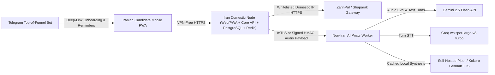

# Project Blueprint & PRD: دویچ‌کوچ (DeutschCoach) — IDEA-006

- **Idea ID:** `IDEA-006`
- **Product Name:** `دویچ‌کوچ` (`DeutschCoach`)
- **Target Market:** `Iran` (Prosumer B1/B2 German Exam & Ausbildung Candidates)
- **Document Mode:** Copy-Ready Repository Blueprint & Product Requirements Document (`PROJECT_BRIEF.md` / `PRD.md`)
- **Verified FX Baseline (Nov 23–24, 2026):** `~271,000–274,700 Toman/USD` (`1 USD ≈ 273,000 Toman` used for unit-economics illustrations; *Assumption* for static projections)
- **Legal Notice:** `دویچ‌کوچ` is an **unofficial AI exam-preparation simulator**. It is **not affiliated with, endorsed by, or connected to Goethe-Institut or ÖSD**, and does not issue official certificates.

---

## 1. Executive Summary & Strict Two-Phase Agent Charter

### 1.1 What `دویچ‌کوچ` Is and Why It Exists
`دویچ‌کوچ` (`DeutschCoach`) is a **Persian-guided AI German oral exam (`Sprechen`) and `Ausbildung` employer-interview simulator** built for Iranian nursing (`Pflege`), technical/IT, and university candidates preparing for **Goethe-Zertifikat B1/B2** and **ÖSD B1/B2** certification.

With **Goethe Tehran (`DSIT`) closed**, thousands of Iranian candidates must fly to **Armenia, Turkey, UAE, Georgia, or Oman** (expensive `$500+` international exam trips covering exam fees, flights, and hotels — *Assumption* anchored on `IDEA-006`) or compete for scarce local **ÖSD/TestDaF** seats. Failing the `Sprechen` module (`< 60/100`) wastes an entire international exam trip. Existing alternatives are either prohibitively expensive (`400,000+ Toman/session` private tutors; `$10–$30/mo` or `2.7M–8.1M Toman/mo` foreign AI apps via currency intermediaries) or lack structured oral exam simulation (CafeBazaar flashcard apps and generic Telegram chatbots).

### 1.2 HARD PHASE-GATE RULE (NON-NEGOTIABLE)
> [!CAUTION]
> **STRICT EXECUTION ORDER FOR ALL REPOSITORY AGENTS:**
> 1. **PHASE 0 FIRST — NO EXCEPTIONS:** Agents in this repository **MUST design, implement, and verify ONLY Phase 0 (48-Hour Validation Harness)** first.
> 2. **PHASE 1 LOCKED:** Agents **MUST NOT** scaffold production web apps, design Phase 1 databases/UI prototypes, provision domestic Iran servers, or implement ZarinPal v4 checkout (**Phase 1**) until the founder explicitly records written confirmation that **Phase 0 passed the Go/No-Go threshold** (`≥ 100` completed diagnostics + `≥ 10` paid pre-orders / `≥ 4,900,000 Toman` collected + `< 3,000 Toman` / `~$0.011` average API cost per evaluation).
> 3. **Why This Gate Exists:** It validates real Iranian willingness to pay in Toman within 48 hours using a disposable `~150`-line Python Telegram diagnostic bot before investing 2–3 weeks in domestic hosting, Enamad (`اینماد`), Tax Tracking Code (`کد رهگیری مالیاتی`), ZarinPal merchant IP whitelisting, and PWA voice UX.

### 1.3 Quick Agent Onboarding Guide
| Agent Role | Phase 0 Responsibility (Active Immediately) | Phase 1 Responsibility (Locked Until Founder Go Sign-Off) |
| :--- | :--- | :--- |
| **`tdd-implementer`** | Build the `~150`-line Python Telegram Diagnostic Bot + automated unit tests for pre-AI audio guards, `1`-eval/user quota, Gemini JSON parsing, and PII-safe logging. | Implement bounded contexts, ZarinPal v4 idempotent checkout, atomic credit ledger, exam state machine, and non-Iran AI proxy worker via strict TDD. |
| **`ddd-architect`** | Inactive unless consulted on Phase 0 proxy/bot isolation. | Define concrete stack (framework choice left open to `ddd-architect`), bounded contexts, split-node domestic/non-Iran topology, and database invariants. |
| **`ui-ux-designer`** | Inactive (Phase 0 uses native Telegram voice notes & inline keyboards). | Design mobile-first Domestic Web/PWA with mixed RTL Persian / LTR German cards, Safari/Chrome `MediaRecorder` flow, and VPN-off checkout UX. |
| **`senior-reviewer`** | Audit Phase 0 code for strict quota/duration guards *before* Gemini calls, error handling, and zero secret/PII logging. | Mandatory `APPROVE` gate on all Phase 1 architecture, UI, financial ledger math (integer Toman), ZarinPal idempotency, concurrency, and security checks. |

---

## 2. Problem, Target Personas & Verified Market Signals

### 2.1 Target Buyer Personas
1. **`Ausbildung` Applicants (`Pflege` / Nursing & Technical Trades):** Need official B1/B2 German certificates to qualify for visa and vocational contracts, plus anxiety around live German employer Zoom/video interviews (shift work, team communication, motivation).
2. **University / `Studienkolleg` / Work-Visa Candidates:** Booked for an upcoming Goethe exam trip abroad (Yerevan, Istanbul, Tbilisi, Dubai, Muscat) or local ÖSD exam within 2–12 weeks and terrified of failing `Sprechen` (`< 60/100`).
3. **Oral-Module Retakers (`Nachprüfung` Candidates):** Already passed `Lesen`, `Hören`, and `Schreiben`, only need `Sprechen`, and cannot afford `400,000+ Toman/session` human tutors 3 times a week.

### 2.2 Competitive Landscape & Arbitrage
| Alternative | Real Cost / Friction in Iran | Structural Gap |
| :--- | :--- | :--- |
| **International Goethe Exam Retake Trip** | `$500+` international exam trip + exam fees (`~136M+ Toman` — *Assumption* anchored on `IDEA-006`) | Huge financial loss if `Sprechen` fails by a few points |
| **Private Iranian German Tutor** | `400,000+ Toman/session` (`1.6M–4.8M Toman/mo` for 1–3x/week) | Expensive, scheduling friction, inconsistent CEFR rubric scoring |
| **Global AI Apps (`TalkPal`, `ChatGPT Plus`)** | `$10–$30/mo` (`2.7M–8.1M Toman/mo` via currency intermediaries) | Requires international card/intermediary, VPN friction, zero Goethe/ÖSD rubric or Persian grammar diagnostics |
| **CafeBazaar German Apps** | Low/freemium | Focused on flashcards/vocabulary; no timed spoken exam simulation |
| **Generic Telegram Bots** | Free/ad-hoc | Unstructured chat, no official Goethe B1/B2 timing, no CEFR error breakdown |

### 2.3 Verified Market Signals & Sources (All Verbatim URLs Preserved)
- **Goethe Tehran (`DSIT`) Closure & International Exam Travel:** Candidates travel to **Armenia, Turkey, UAE, Georgia, or Oman** where exam seats fill rapidly → [iranvisametric.com](https://vertexaisearch.cloud.google.com/grounding-api-redirect/AUZIYQEmVluOn521tdHRF7pspGlGXz2VlkMerDBEN5EPmYbLcTu9TRZgcbMjjsyIL3jHUHGKdeo5vq0mjCpn8eNN4rxAAhFdwZ4MiiOHga0jG2Yocu6phMfv_Qc=)
- **Local Alternatives (`ÖSD` / `TestDaF`):** Iranian candidates also rely on local ÖSD/TestDaF sittings → [gmt-academy.com](https://vertexaisearch.cloud.google.com/grounding-api-redirect/AUZIYQGnSQ2C8LL3S8B6xML34PjCb9RrdWZyfI8Y3bxWOo8vAQZkZZfBQrCXM4eLHuMYqWchGyKuVCEW9l6n6qrZ2vTzutJPxkL0hmHfd5cYutUxT56ZteKgMPZALT2oHWe2iLAJSvOheji1s3bvuCAu4wCyr1T-IqjNLq8XbCFg)
- **Ausbildung Language Requirement:** B1/B2 German required for vocational `Ausbildung` admission → [go2tr.com](https://vertexaisearch.cloud.google.com/grounding-api-redirect/AUZIYQGlFsulCDX4edvSy_595PxV3S41V-paOn_rUI4AgB_P6HtRVruV740m3juOmMY2LLQaiGmSCbAajO7EbvD0emHULu5_jBnw9wAyGCeCMhg-KUV3JNi4H64JjXjx85Aslte3SxdQDN4_H0Ux5E0mX77E)
- **Human Tutor Pricing Benchmark:** Private German tutoring costs **`400,000+ Toman/session`** → [sanjagh.pro](https://vertexaisearch.cloud.google.com/grounding-api-redirect/AUZIYQE6_L0bIBGUn6hCssHgC926vDXH2C8uqsQBMYLB_WFc3cU9Dul987mcJ1SfEpHrUJu5y5xJ4a_D5u-mOzVVzHN2AONtNQ70bkw9f6ATtM15TpqfBV5rXon9U5ZvKuUiWDwkB7MvPUy2WHiDJ64Zw2wREZupA4oejCXpxcFJ3d-KL_8wf5_mU5CkS-1JJcIe9r6Ucm4oLVmIyuzPdjt1k4gN1k2EKZqGjO7Rz1Q=)
- **Global AI Payment Friction:** Dollar AI apps (`$10–$30/mo`) cost `2.7M–8.1M Toman/mo` via Iranian currency intermediaries → [iranicard.ir](https://vertexaisearch.cloud.google.com/grounding-api-redirect/AUZIYQHJ3IviyLAl_IbCTFds4MiaHKCEWUtThSQ3nrnev-jFkZ59aOHZKPw-IN7-RpoE1EFtSJTvC9rNnwmX8rIOiBveVRZDQB5JTtKamRA_QCCnYQeNxDqTlyQyuVOejqy1F__KrIoVQ5AD_tJoCZAE5GdUggEBSSGank0=)
- **Local App Gap:** CafeBazaar German apps focus on vocabulary/flashcards rather than exam speaking → [cafebazaar.ir](https://vertexaisearch.cloud.google.com/grounding-api-redirect/AUZIYQE9xzOM8ihT9c2Pt7AP6wpVEGm3VPUrcJ7dIck2Y4bfFt9-HcLBzpjZnckJQPsDgpVsk0x3SMZCJ1CVA17ge54LwSvo11jCbMEmyacvnZjec02k1a9ejHmlt1dTE_2ky-UjAuW1MPYxf9mOQxBOdKY=)
- **Telegram Bot Gap:** Generic Telegram bots lack structured voice exam simulation UX → [dicardo.com](https://vertexaisearch.cloud.google.com/grounding-api-redirect/AUZIYQGWes_j2At9z7ADcISFsFL7s2DDS-wzSGVjbMBlw7ilO7AkP3iDVsCLKXxYKlH74PEwb_Pq8jZpDJQDO4KaVK7SOUKev76vtPGo4ujesCWeHMVdWQUOedLskbfAkaMV_cDgYD0=)
- **Verified FX Sources (Nov 24, 2026 — `~271,000–274,700 Toman/USD`):** [bartarinha.ir](https://vertexaisearch.cloud.google.com/grounding-api-redirect/AUZIYQHnRWQnw_0GthBscU7efUYbBZriE29z-7hdOtPnGz5y6NnO5NmAsF01OmgWAcZr7MCCxjQMCCv8IxpcAa-GShA3ConE5y9DvMCEE2X6XVhkoJVaVEQErSGt_9L_IxNxVeBXqU1RR-5YyTjdK8bP7khtMNtbFDq9I1jarkEmYw3hZlJKyethHTaNVfUaG5YG2yb_BlNCZYw9lEIU9hS9zjCyO8mC5L2_aEnkAq3ttt4kdu5XOMNjynJj-uw9g-E_mOKCx98IEk9c7K1DgrGNy1wwOSlvD87gzRt7e1fm1x_y-Pgynd4PxqCD0b4McArb06lBmzwQRwEhQO-49F6IjVUZ6vMFdvMHlHUSUftgPcv9KfrSbUMIUx2uC6OZwo5gy5vB8kcoXiH55vNwbPc19iWZIr39nZNenX1rF4PueOKt_7XHEIoCNzxWYPe0bPSFYg==), [alanchand.com](https://vertexaisearch.cloud.google.com/grounding-api-redirect/AUZIYQFMN-YmyF_9mcK7WRDH7aAR5U-Cf7ITq45l8XoLgqpFyZi7LEsMaAA1TvbmJ4pFx_mcX2XttR1WapJpatoNmmr8jv0cLW8qY4Ed4kphXe8bO91LZAN07L-q1ST_qxLs2yk=)

---

## 3. Non-Negotiable Iran Technical, Payment & Financial Guardrails

### 3.1 Shaparak / ZarinPal VPN & Regulatory Constraint
1. **Why Telegram Mini-App Checkout Fails in Production:** Telegram is filtered inside Iran, so users keep VPNs **ON** while inside Telegram. Shaparak and ZarinPal checkout pages block or fail transactions originating from foreign/VPN IPs.
2. **Server IP Whitelisting & Error `-10`:** ZarinPal API v4 strictly enforces **domestic server outbound IP whitelisting** on `request` and `verify` calls. Calling ZarinPal from a foreign VPS or an unregistered proxy/Cloudflare IP triggers **Error `-10`** (`Terminal is not valid, please check merchant_id or ip address`).
3. **Merchant Compliance:** Activating a production ZarinPal gateway requires **Enamad (`اینماد`)** (including micro-business `اینماد بدون ستاره` where eligible) and a **Tax Tracking Code (`کد رهگیری مالیاتی`)** matching the merchant's National ID and IBAN (`شبا`).
4. **Architectural Mandate:**
   - **Phase 1 MUST be a Domestic-Hosted Web App / PWA** running on an Iranian datacenter server/IP (for Shaparak compatibility, VPN-free speed, and Persian Google SEO).
   - **Telegram MUST be strictly a top-of-funnel acquisition, free diagnostic hook, and daily practice/reminder bot** that links out to the domestic web domain (`https://<domain>/...`) — **NEVER trap ZarinPal checkout inside a Telegram Mini-App WebView**.

### 3.2 Anti-Margin-Inversion Audio Stack
> [!NOTE]
> *Assumptions (Unverified Vendor Pricing):* All third-party AI API rates cited below (OpenAI Whisper/TTS, Gemini 2.5 Flash audio/text, Groq `whisper-large-v3-turbo`) are working estimates as of Nov 2026 and **MUST be verified against live vendor rate cards before production build**.

1. **Explicitly Forbidden Stack & Pricing:**
   - **FORBIDDEN:** Uncapped `590,000 Toman/mo` subscriptions running on **OpenAI Whisper (`$0.006/min`) + OpenAI TTS (`~$0.015/min`) + high-cost chat LLMs**.
   - **Why It Breaks Margin:** OpenAI Whisper + TTS alone cost `~$0.021/min` (`~5,730 Toman/min`); with conversational LLM tokens (`~$0.025/min` total = `~6,825 Toman/min`), a user practicing just 25 minutes/day burns ~750 minutes/month = `~$18.75` (`~5.1M Toman`), causing severe **margin inversion past ~86–250 mins/month** depending on LLM overhead.
2. **Mandated Commercial & Audio Architecture:**
   - **Minute/Mock-Capped Upfront Exam Packs (Zero Uncapped Plans):** Sell fixed-pack mocks with explicit per-mock (`≤ 12` user audio mins) and daily rolling caps (`≤ 3` mocks or `35` mins/24h).
   - **Phase 0 & Single-Pass Multimodal Evaluator:** **Gemini 2.5 Flash native audio input** (`$1.00/1M` audio input tokens at `32 tokens/sec` = `1,920 tokens/min` = `$0.00192/min`; text input `$0.30/1M`; output `$2.50/1M`). A 90-second voice diagnostic (`2,880` audio tokens + `~400` prompt tokens + `~800` output tokens) costs **`~$0.005` (`~1,365 Toman`)** — staying safely under **`$0.011` (`~3,000 Toman`)** per diagnostic even with thinking/retry headroom.
   - **Phase 1 Multi-Turn Roleplay Stack:** Combine **Groq `whisper-large-v3-turbo`** (`$0.04/hr` = `~$0.00067/min`, 10s minimum billing) for fast turn-by-turn STT + **Gemini 2.5 Flash** for conversational partner turns and final audio/rubric grading + **open-weights self-hosted German TTS (`Piper` / `Kokoro` on VPS)** with pre-cached static audio for examiner instructions and fixed transitions (`$0` marginal TTS token cost).
   - **Non-Iran AI Proxy Isolation:** Host the AI inference worker (Gemini/Groq + Piper/Kokoro TTS) on a **non-Iran VPS**, isolated from the domestic Iran web/payment/DB server and authenticated via mTLS or signed HMAC internal tokens, so geo-blocks never hit Google/Groq and Shaparak never sees foreign IPs.

### 3.3 Engineering Safety & Financial Invariants
1. **Exact Integer Currency Accounting:** Store all prices, balances, ledger entries, ZarinPal amounts, and affiliate commissions as exact **integers (`BIGINT` / `int`) in `Toman` or `Rial`** — **NEVER use `float` or `double`**. Pin ZarinPal v4 `currency` (`"IRT"` for Toman or `"IRR"` for Rial with explicit `× 10` conversion) in configuration and unit-test it.
2. **Idempotent ZarinPal `verify` & Order Fulfillment:**
   - Never trust redirect query params (`Status=OK`) alone; always call server-side `POST https://payment.zarinpal.com/pg/v4/payment/verify.json` with server-stored `amount` and `authority`.
   - Enforce **`UNIQUE` constraints on `authority` and `ref_id`** in the payment table.
   - Handle ZarinPal `code === 100` and `code === 101` uniformly as verified states (when persisted `amount` matches): execute the atomic conditional transition `UPDATE payments SET status = 'PAID', ref_id = ... WHERE id = ... AND status = 'PENDING'`. Only the request whose `UPDATE` affects **`1` row** atomically creates the credit lot and affiliate commission (recovering safely even on a `code 101` retry if an earlier callback crashed after ZarinPal `verify` and before DB commit); if **`0` rows** are affected (order is already `PAID`), return the existing paid receipt idempotently **without double-crediting**.
3. **Atomic Credit Deduction & Pre-AI Guards:**
   - Validate **before** calling any paid AI API: user authentication, per-user/IP rate limits, file size (`≤ 5 MB`), allowed MIME/container (`audio/ogg`, `audio/webm`, `audio/mp4`, `audio/mpeg`), and **actual decoded audio duration** (`15s ≤ duration ≤ 125s` per turn via server-side container inspection / `ffprobe` — giving a `5s` encoding-jitter tolerance above the `120s` UI auto-stop — never client-reported length).
   - Deduct/reserve mock credit atomically (`remaining_units >= 1`) in a short DB transaction **before** calling the AI worker; only issue a compensating credit refund in a separate short transaction if the AI worker fails with a non-user transient error.
4. **Zero DB Locks Across External HTTP/AI Calls:** Never hold open database transactions or row locks during ZarinPal HTTP requests or Gemini/Groq audio inference.
5. **Secret, Receipt & PII Hygiene:** Never log API keys, `merchant_id`, OTP codes, full phone numbers, bank card numbers, or unconsented audio/transcripts in plaintext logs. Auto-purge Phase 0 raw audio files after `24` hours.

---

## 4. Phase 0 — 48-Hour Validation Harness Spec (BUILD THIS FIRST, ~4 Hours)

> [!IMPORTANT]
> **Phase 0 Build Target:** One disposable `~150`-line Python Telegram Diagnostic Bot deployed on a **non-Iran VPS**, backed by SQLite + append-only JSONL telemetry. Zero web frontend, zero Enamad, zero ZarinPal API code required in Phase 0.

### 4.1 Exact Phase 0 User Flow
1. **Command `/start`:** Bot greets the candidate in natural Persian, states the unofficial AI prep disclaimer, and renders inline buttons to select target level: **`B1`** or **`B2`**.
2. **Timeline Selection:** Inline buttons asking exam urgency:
   - `کمتر از ۱ ماه دیگر` (`<1 month`)
   - `۱ تا ۳ ماه دیگر` (`1–3 months`)
   - `تازه شروع کرده‌ام` (`Just starting`)
3. **Prompt Delivery:** Bot sends **1 authentic Goethe Sprechen Prompt Card** matching the selected level (`B1` → **B1 Teil 2 Präsentation**; `B2` → **B2 Teil 1 Vortrag / Stellungnahme**) with German text + crisp Persian instructions (`۳۰ تا ۱۲۰ ثانیه وُیس بفرستید`).
4. **Single-Voice Diagnostic & Pre-AI Guards:**
   - User replies with **1 Telegram voice note** (`audio/ogg` Opus).
   - **Guard 1 (Atomic Quota Reservation):** Enforce strict **`1` free evaluation per `telegram_user_id`** (plus configurable admin whitelist IDs for internal QA). Reserve the entitlement atomically (`AVAILABLE → RESERVED`) in a short SQLite transaction *before* downloading/calling Gemini (never hold SQLite locks across HTTP; compensate back to `AVAILABLE` only if Gemini fails with a transient error). If already used/reserved, block before Gemini call and display the Founder-Beta CTA.
   - **Guard 2 (Pre-Download Metadata Filter + Post-Download `ffprobe` Duration Check):** First check Telegram's `voice.duration` and `file_size` (`≤ 5 MB`) to skip obviously invalid blobs, then after downloading `.ogg` bytes **re-verify actual decoded duration via `ffprobe`/OGG container header** (`15s ≤ duration ≤ 125s`) *before* calling Gemini so spoofed `voice.duration` metadata cannot sneak 40-minute Opus files into the API:
     - Reject `< 15s` (`«وُیس شما خیلی کوتاه است (زیر ۱۵ ثانیه). لطفاً حداقل ۳۰ تا ۹۰ ثانیه صحبت کنید؛ سهمیه رایگان شما مصرف نشد.»` — release reservation)
     - Reject `> 125s` (`«حداکثر زمان مجاز ۱۲۰ ثانیه است. لطفاً فشرده‌تر ضبط و ارسال کنید؛ سهمیه رایگان شما مصرف نشد.»` — release reservation)
5. **Gemini 2.5 Flash Evaluation:** Invoke **Gemini 2.5 Flash** using the verified `.ogg` audio and the exact prompt in Section 4.3, log token usage & estimated USD/Toman cost, finalize quota `RESERVED → CONSUMED` (or revert to `AVAILABLE` on transient API error), and delete temp audio immediately.
6. **Scored Persian Report + Founder-Beta Pre-Order CTA:** Return structured Persian scorecard (`0–100`, band, 4 rubric sub-scores, **top 3 exact mistakes quoted from their audio** with corrected German + Persian explanation, and 1 timeline-tailored tip), immediately followed by the Founder-Beta CTA.

### 4.2 Verbatim Sample Prompt Cards (Ready to Ship)

#### Card A — `Goethe-Zertifikat B1 — Sprechen, Teil 2 (Thema präsentieren)`
```text
🇩🇪 کارت آزمون شفاهی گوته B1 — بخش دوم (ارائه موضوع)

Thema: „Brauchen Jugendliche heute ein eigenes Smartphone?“

در یک فایل صوتی بین ۶۰ تا ۹۰ ثانیه به زبان آلمانی، این ۵ بخش را به ترتیب پوشش دهید:
1. Einleitung: Mein Thema ist ... (معرفی موضوع)
2. Persönliche Erfahrungen: Meine eigenen Erfahrungen damit (تجربه شخصی شما)
3. Situation im Heimatland: Wie ist die Situation im Iran? (وضعیت در ایران)
4. Vor- und Nachteile: Was spricht dafür, was dagegen? (مزایا و معایب)
5. Abschluss und Dank: Meine Meinung + Vielen Dank für Ihre Aufmerksamkeit (جمع‌بندی و تشکر)

🎙️ همین الان وُیس خودتان را ضبط و ارسال کنید (۳۰ تا ۱۲۰ ثانیه).
```

#### Card B — `Goethe-Zertifikat B2 — Sprechen, Teil 1 (Vortrag / Stellungnahme)`
```text
🇩🇪 کارت آزمون شفاهی گوته B2 — بخش اول (سخنرانی و اعلام موضع)

Thema: „Gesund leben am Arbeitsplatz — wie können Berufstätige trotz Stress und Schichtarbeit gesund bleiben?“

در یک فایل صوتی بین ۹۰ تا ۱۲۰ ثانیه به زبان آلمانی، ارائه ساختارمند بدهید و این موارد را پوشش دهید:
1. Einstieg & Relevanz: Warum ist dieses Thema heute besonders wichtig?
2. Verschiedene Möglichkeiten nennen: Welche Maßnahmen gibt es (z. B. Bewegung, Ernährung, Pausen, Arbeitszeitmodelle)?
3. Eine Möglichkeit genauer beschreiben & Vor-/Nachteile abwägen.
4. Eigene Stellungnahme & Fazit: Welche Lösung halten Sie für am sinnvollsten und warum?

🎙️ همین الان وُیس خودتان را ضبط و ارسال کنید (۳۰ تا ۱۲۰ ثانیه).
```

### 4.3 Copy-Ready Gemini 2.5 Flash Goethe CEFR Sprechen Grading Prompt
Use `response_mime_type="application/json"` with strict schema validation and fallback safe formatter if any field is missing.

```text
SYSTEM PROMPT:
You are an experienced, strict, yet constructive Goethe-Institut certified B1/B2 oral examiner ("Prüfer") who coaches Iranian Persian-speaking candidates.
You are evaluating an unscripted audio recording from a candidate practicing for Goethe Sprechen.

CRITICAL ANTI-HALLUCINATION & STRICTNESS RULES:
1. Listen directly to the attached audio. NEVER invent mistakes the speaker did not say.
2. Every item in "top_3_errors" MUST include an "exact_spoken_excerpt" quoted verbatim from what the speaker actually said in the audio (including grammatical/pronunciation/lexical mistakes). If the speaker spoke less than 20 seconds or gave off-topic/non-German audio, score appropriately (< 35) and explain honestly in Persian.
3. Score strictly according to authentic Goethe-Zertifikat CEFR B1 or B2 standards:
   - Passing score is 60/100 ("قبول"). 50–59 is borderline ("لب مرز"). < 50 is failing ("نیاز به تمرین فوری / رد").
   - Evaluate 4 dimensions out of 25 points each (sum = total_score 0..100):
     a) task_fulfillment (Aufgabenerfüllung / پوشش ساختار و نکات کارت)
     b) coherence_interaction (Kohärenz & Redemittel / انسجام، جملات ربط و ساختار ارائه)
     c) vocab_grammar (Wortschatz & Strukturen / دایره واژگان و دقت گرامری سطح هدف)
     d) pronunciation_fluency (Aussprache & Flüssigkeit / تلفظ، آهنگ کلام و روانی)
4. Write all feedback, explanations, and coaching tips in crisp, natural, encouraging yet honest Persian (Farsi), keeping German examples/corrections in German script.
5. Output ONLY valid JSON matching the exact schema below.

USER PROMPT:
Evaluate this candidate recording.
- Target Level: {{LEVEL}}   (B1 or B2)
- Exam Timeline: {{TIMELINE}}
- Prompt Card Given: {{PROMPT_TITLE_AND_BULLETS}}

Return JSON with this exact structure:
{
  "is_valid_german_attempt": true,
  "transcript_summary_de": "Brief 2-3 sentence faithful summary/excerpt of what the user actually said in German",
  "total_score": 0,
  "band": "قبول | لب مرز | رد",
  "subscores": {
    "task_fulfillment": 0,
    "coherence_interaction": 0,
    "vocab_grammar": 0,
    "pronunciation_fluency": 0
  },
  "top_3_errors": [
    {
      "category": "Grammatik | Aussprache | Wortschatz | Struktur",
      "exact_spoken_excerpt": "exact wrong phrase heard in audio",
      "corrected_german": "natural corrected B1/B2 German sentence",
      "explanation_fa": "clear 1-2 sentence explanation in Persian of why it lowers the Goethe score"
    }
  ],
  "strength_fa": "1 sentence highlighting what the candidate already did well",
  "timeline_action_plan_fa": "1-2 concrete sentences tailored to their timeline ({{TIMELINE}}) telling them what to fix before exam day"
}
```

### 4.4 Founder-Beta Pre-Order Offer & Phase 0 Payment Flow
Immediately after delivering the scored Persian report, send this offer message:
- **Offer:** **Founder-Beta Exam Pack** — **`490,000 Toman`** *(discounted from `790,000 Toman` public launch price)*
- **What's Included:** **`10` full graded B1/B2 Sprechen mocks (Parts 1–3 / Teil 1–2) + `Ausbildung` interview drills** on the upcoming **VPN-free domestic web app launching in `≤ 14 days`**, **`90`-day validity**, and an explicit **100% money-back refund guarantee** if launch slips past 14 days or if the user isn't satisfied after their first full web mock.
- **Payment Rails (Phase 0 Only — Zero Enamad Delay):**
  - **Primary Option — ZarinLink (`زرین‌لینک`):** Direct payment link (note: `ZarinLink` still requires ZarinPal merchant KYC and a personal Tax Tracking Code `کد رهگیری مالیاتی`, even though it bypasses website Enamad — making Card-to-Card essential as Day-1 fallback) with a prominent Persian warning: **`⚠️ نکته بسیار مهم: قبل از زدن لینک پرداخت، حتماً فیلترشکن (VPN) را خاموش کنید تا درگاه شاپرک خطا ندهد.`** After paying, user sends the tracking number/screenshot to the bot/founder handle.
  - **Fallback Option — Card-to-Card (`کارت‌به‌کارت`):** If ZarinLink is unavailable on Day 1, accept receipt image or last-4-digits + timestamp inside the bot, reconciled manually via `/approve <telegram_user_id> <tx_ref>` (never log full card numbers).

### 4.5 Ready-to-Paste Persian Distribution & Follow-Up Playbook
1. **Target Telegram Search Keywords:**
   - `نمونه سوالات آزمون گوته B1 B2`
   - `آوسبیلدونگ پرستاری`
   - `سفر آزمون گوته ارمنستان ترکیه امارات`
   - `آزمون ÖSD تهران`
   - `مهاجرت کاری آلمان B1 B2`
2. **Community Outreach Post (Value-First, Anti-Spam):**
   > سلام دوستان! 👋
   > می‌دونیم با بسته شدن گوته تهران، هزینه سفر آزمون به ارمنستان، ترکیه یا امارات خیلی بالاست و رد شدن توی بخش **Sprechen** یعنی سوخت شدن کل هزینه سفر.
   > ما برای بچه‌های B1 و B2 یک ابزار ارزیابی تخصصی ساختیم که **دقیقاً طبق معیار نمره‌دهی گوته**، روی وُیس واقعی خودتون بهتون نمره از ۱۰۰ می‌ده و **۳ اشتباه دقیق گرامر، تلفظ و ساختار** خودتون رو با اصلاحیه‌اش به فارسی درمیاره.
   > هر نفر می‌تونه **یک تست تعیین سطح واقعی (۶۰ تا ۹۰ ثانیه)** رو کاملاً رایگان امتحان کنه تا ببینه الان لب مرزِ قبولیه یا آماده آزمونه:
   > 👉 `@DeutschCoachTestBot`
   > امیدوارم به کارتون بیاد و آزمون رو بار اول پاس کنید 🇩🇪✨
3. **Independent German Tutor Referral Pitch (`25%` Affiliate Cut):**
   > سلام استاد [نام] عزیز، وقت بخیر 🙏
   > حتماً شاگردهایی دارید که قبل از سفر آزمون گوته یا مصاحبه آوسبیلدونگ استرس بخش **Sprechen** دارن و بین جلسات خصوصی به تمرین روزانه با نمره‌دهی دقیق نیاز دارن.
   > ما پلتفرم **دویچ‌کوچ** رو ساختیم (مکمل تمرین بین جلسات شما، نه جایگزین مدرس) که شبیه‌ساز آزمون گوته B1/B2 و مصاحبه کاری آوسبیلدونگ هست. برای مدرسان هم **۲۵٪ پورسانت دائمی** روی هر پکیج در نظر گرفتیم (یعنی `۱۲۲,۵۰۰ تومان` روی پکیج بتای `۴۹۰ هزار تومانی` و `۱۹۷,۵۰۰ تومان` روی پکیج استاندارد `۷۹۰ هزار تومانی` به ازای هر شاگرد).
   > اگر مایل باشید یک لینک اختصاصی رایگان برای خودتون بفرستم که اول خودتون کیفیت تصحیحش رو تست کنید؟
4. **Hour-36 Polite Follow-Up Message (via Bot to Unpaid Diagnostic Finishers):**
   > سلام [نام/دوست گرامی] 👋
   > دیروز نمره بخش Sprechen شما توی دویچ‌کوچ **`{{SCORE}}/100` ({{BAND}})** شد. اگر تا ۳ ماه آینده آزمون گوته/ÖSD یا مصاحبه آوسبیلدونگ دارید، حیف است قبل از آزمون فقط با چند تا تمرین پراکنده ریسک کنید.
   > ظرفیت **تخفیف بتای بنیان‌گذار (`۴۹۰ هزار تومان` به‌جای `۷۹۰ هزار تومان`)** برای پکیج **۱۰ آزمون کامل نمره‌دهی‌شده + تمرین مصاحبه آوسبیلدونگ** روی وب‌اپ بدون فیلترشکن، تا فردا شب باز است (با اعتبار ۹۰ روزه و **گارانتی ۱۰۰٪ بازگشت وجه**).
   > برای رزرو پکیج با قیمت بتا از دکمه زیر استفاده کنید 👇

### 4.6 Phase 0 Telemetry & Quantitative Go / Pivot / No-Go Gate
Log every event cleanly in SQLite + JSONL (`telegram_user_id`, `level`, `timeline`, `audio_duration_sec`, `gemini_input_tokens`, `gemini_output_tokens`, `estimated_cost_usd`, `score`, `band`, `cta_clicked`, `payment_submitted`, `payment_verified`, `source_tag`, `created_at`).

| Decision | Hard Quantitative Threshold | Required Action |
| :--- | :--- | :--- |
| **`GO` (Unlock Phase 1)** | **`≥ 100` completed diagnostics** AND **`≥ 10` paid pre-orders (`≥ 4,900,000 Toman` collected)** AND **`< 3,000 Toman` (`~$0.011`) avg API cost per eval** | Founder issues written `PHASE_0_PASSED` sign-off; unlock `ddd-architect` + `ui-ux-designer` + Phase 1 build. |
| **`PIVOT` (Diagnose & Re-test 48h)** | `5–9` paid pre-orders OR strong diagnostic completion (`≥ 80`) with checkout drop-off (e.g., VPN errors on ZarinLink) | Diagnose drop-off (`ZarinLink` VPN blocks vs. CTA wording vs. prompt quality), switch to card-to-card/adjust offer, run one 48h re-test. |
| **`NO-GO` (Kill & Refund)** | **`< 5` paid pre-orders out of `≥ 100` completed diagnostics** OR **`< 50` free diagnostics** achievable after seeding 10+ active communities | **Immediately refund 100% of early beta payers**, archive Phase 0 learnings, and pivot founder time to **`IDEA-013` (`اپلای‌پرو`)**. |

---

## 5. Phase 1 — Domestic Web/PWA Production MVP PRD (LOCKED UNTIL PHASE 0 PASSES)

> [!WARNING]
> **DO NOT IMPLEMENT THIS SECTION** until the founder explicitly confirms `PHASE_0_PASSED`.

### 5.1 MVP Scope vs. Explicit Non-Goals
| In Phase 1 MVP Scope | Explicit Non-Goals (Strictly Excluded) |
| :--- | :--- |
| Domestic-hosted mobile-first **Web App / PWA** (Iran IP for VPN-free UX + Shaparak) | Native iOS App Store / Google Play binaries |
| Passwordless Auth (Iranian mobile SMS OTP + optional Telegram account link) | Email/password recovery flows or OAuth social logins |
| Free 90-second Diagnostic Funnel (web + Telegram bot deep-link) | Unlimited / uncapped monthly subscription plans |
| Domestic **ZarinPal v4** Exam Pack checkout (`code 100`/`101` idempotent verify) | Telegram Mini-App WebView payments or crypto/Telegram Stars checkout |
| Timed **Goethe B1 (`Teil 1–3`)**, **Goethe B2 (`Teil 1–2`)**, and **ÖSD B2 (`Aufg. 1–3`)** turn-based `Sprechen` simulator | `Lesen` (Reading), `Schreiben` (Writing), or standalone `Hören` (Listening) exam modules |
| **`Ausbildung` Employer Interview Roleplay** (`Pflege` / Nursing & `Technik/IT` tracks) | Live human tutor marketplace, booking calendars, or escrow |
| Persian CEFR Scorecard + exact error excerpts + progress history | Fragile real-time WebRTC / SIP live voice streaming calls (use reliable chunked push-to-talk audio turns) |
| German Tutor Affiliate Dashboard (`25%` commission ledger + referral links) | Automated bank IBAN payouts (manual weekly settlement by founder in Phase 1) |

### 5.2 Core User Flows
- **Flow A — Onboarding & Free 90s Diagnostic:** Candidate arrives via Telegram bot deep-link or Persian SEO → signs in via SMS OTP (or Telegram one-time link code) → picks `B1` / `B2` → records one 30–120s push-to-talk diagnostic → receives Persian CEFR scorecard + error highlights → sees Exam Pack upgrade prompt.
- **Flow B — Domestic ZarinPal Checkout:** Candidate selects an Exam Pack → views bold pre-redirect reminder (**`لطفاً پیش از ورود به درگاه بانک، فیلترشکن را خاموش کنید`**) → backend creates pending order (`integer Toman`) and calls ZarinPal `request.json` → redirects to `payment.zarinpal.com` → callback verifies `Authority` & `amount` server-side via `verify.json` (`100`/`101` idempotent) → unlocks pack credits → shows receipt + `RefID`. *(Plus a founder-admin grant/voucher endpoint to provision Phase 0 `490,000 Toman` Founder-Beta pre-order buyers with their `10`-mock + `Ausbildung` pack and `90`-day validity upon Phase 1 launch.)*
- **Flow C — Full Timed Goethe/ÖSD `Sprechen` Simulation:**
  - **Goethe B1 (`Teil 1–3`):** Optional `15`-minute prep notepad timer (skippable for quick drill) → **Teil 1** (*Gemeinsam etwas planen*, ~3 min multi-turn dialogue with AI partner across 4 bullet points) → **Teil 2** (*Thema präsentieren*, ~3 min structured monologue choosing 1 of 2 prompt cards) → **Teil 3** (*Feedback & Fragen*, ~2 min reacting to AI partner's audio presentation + answering partner/examiner follow-up).
  - **Goethe B2 Modular (`Teil 1–2`):** Optional `15`-minute prep timer → *Einführungsgespräch* (1 short ungraded warm-up turn) → **Teil 1** (*Vortrag halten*, ~4 min structured presentation/Stellungnahme + follow-up question) → **Teil 2** (*Diskussion führen*, ~5 min multi-turn debate reaching consensus).
  - **ÖSD B2 (`Aufgaben 1–3`):** Optional `15`-minute prep timer → *Aufgabe 1* (*Informationsgespräch*) → *Aufgabe 2* (*Bild-/Themenbesprechung*) → *Aufgabe 3* (*Diskussion / Meinungsäußerung*).
  - **Mechanics:** All spoken interaction uses **turn-based chunked push-to-talk audio** (user taps record → stops/auto-stops at turn limit → uploads compressed audio → AI partner responds via cached/Piper German TTS + text transcript toggle).
- **Flow D — `Ausbildung` Employer Interview Roleplay:** User chooses `Pflege (پرستاری)` or `Technik / IT` → AI German HR/unit manager conducts 5–7 spoken turns probing motivation, shift-work resilience, German workplace scenarios, and relocation readiness → returns German fluency + HR-readiness Persian evaluation.
- **Flow E — German Tutor Affiliate Dashboard:** Approved tutors generate unique referral codes (`?ref=TUTOR_CODE`), view attributed paid pack counts, accrued `25%` commission ledger (`Toman`), and settlement history.

### 5.3 User Stories & Testable Acceptance Criteria
- **`US-01` (Auth & Free Diagnostic Enforcement):** As a new Iranian candidate, I sign in via SMS OTP (or Telegram deep-link token) and get exactly 1 free 90s diagnostic.
  - *AC:* Duplicate phone numbers or Telegram IDs cannot claim >1 free diagnostic; short/invalid audio (`< 15s` or `> 125s`) never consumes the free entitlement.
- **`US-02` (Atomic Credit Ledger & Caps):** As a paid candidate, my purchased Exam Pack credits and validity window (`60` or `90` days) are accurately tracked with daily caps (`≤ 3` mocks or `35` spoken mins/24h).
  - *AC:* Concurrent start requests against a `1`-credit balance succeed for at most 1 session; expired lots cannot be consumed; money/credits never use floats.
- **`US-03` (Domestic ZarinPal Idempotent Checkout):** As a buyer, when ZarinPal redirects back to `/payments/callback`, my pack is credited exactly once even if I refresh or hit network retries.
  - *AC:* Callback ignores client `Status` spoofing and calls server-side `verify.json` with persisted `amount`; both `code 100` and `code 101` execute the atomic conditional transition `PENDING → PAID` (`1` row affected credits pack + commission once, recovering safely from mid-callback crashes even on `code 101`; `0` rows affected returns the existing receipt without double-crediting); mismatched amount/authority marks order failed.
- **`US-04` (Pre-AI Audio Guardrails):** As the platform operator, oversized, corrupted, wrong-MIME, or out-of-bounds duration uploads are blocked before reaching the non-Iran AI proxy.
  - *AC:* Server inspects real container duration (`15s ≤ d ≤ 125s` per turn, allowing `5s` jitter above `120s` UI auto-stop) and size (`≤ 5 MB`) and enforces per-user rate limits before forwarding bytes to the AI worker.
- **`US-05` (Resilient Exam Session State Machine):** As an exam candidate on unstable mobile 4G, if an upload drops or the AI worker times out, I can retry that turn without losing my paid mock credit.
  - *AC:* Session transitions (`PREP` → `PART_1` → `PART_2` → `PART_3` → `GRADING` → `COMPLETED` | `FAILED_REFUNDED`) persist every turn; transient AI worker failure triggers credit compensation only via idempotent state transition.
- **`US-06` (`Ausbildung` Interview Track):** As a nursing or technical `Ausbildung` applicant, I can spend 1 mock credit on a 5–7 turn employer interview simulation and get role-specific German phrasing upgrades.
  - *AC:* Session runs 5–7 spoken turns with domain-specific HR rubric criteria and generates a Persian feedback scorecard.
- **`US-07` (Bilingual Scorecard & History):** As a returning user, I can review past mock scores (`0–100`), sub-scores, exact spoken mistakes, corrected German phrases, and audio/text partner prompts.
  - *AC:* UI isolates German text (`dir="ltr"`) inside Persian (`dir="rtl"`) cards with zero bidirectional punctuation scrambling.
- **`US-08` (Tutor Affiliates & Cost Telemetry):** As a tutor partner or founder admin, referrals attribute `25%` commission on verified paid orders and admin views track per-mock API COGS.
  - *AC:* Commission ledger entries link `1:1` to verified order IDs (never created on pending/failed orders, reversed on refunds); admin dashboard displays real token/audio spend per mock in integer Toman (plus USD micro-cost at 4–6 decimal places for API telemetry).

### 5.4 Monetization, Unit Economics & KPIs (*Assumptions*)
All unit-economic projections below are explicitly labeled as ***Assumptions*** anchored on the verified `~273,000 Toman/USD` FX baseline (`Nov 23–24, 2026`).

- **Exam Pack Catalog (*Assumptions*):**
  1. **Starter Exam Pack — `790,000 Toman`** (`~$2.89`): **`10` Full Graded Mocks** (`≤ 12` user audio mins/mock = `120` mins max), **`60`-day validity**, all Goethe/ÖSD B1 & B2 tracks.
  2. **Exam-Trip / `Ausbildung` Pro Pack — `1,490,000 Toman`** (`~$5.46`): **`25` Full Graded Mocks + `Ausbildung` Interview Suite** (`≤ 12` user audio mins/mock = `300` mins max), **`90`-day validity**.
  3. **Hard Daily Abuse Cap:** `≤ 3` full mocks or `35` spoken user minutes per rolling 24 hours.
- **Per-Mock & Pack COGS Breakdown (*Assumptions*):**
  - Turn-by-turn STT via **Groq `whisper-large-v3-turbo`** (`$0.04/hr` = `~$0.00067/min` × `10` mins) = `~$0.0067`
  - Conversational AI partner text turns (`Gemini 2.5 Flash`) = `~$0.004`
  - Self-hosted cached German TTS (`Piper` / `Kokoro` on non-Iran VPS) = `~$0` marginal token cost (`~$10–$20/mo` fixed VPS amortized)
  - Final **Gemini 2.5 Flash native audio pass** (`8–10` mins key audio @ `$1.00/1M` tokens × `32 tokens/sec` + rubric output) = `~$0.018–$0.025`
  - **Total AI COGS per Full 10-Min Mock:** **`~$0.029–$0.040` (`~7,900–10,900 Toman/mock`)**
  - **10-Mock Starter Pack (`790,000 Toman`) Economics:**
    - AI COGS (10 mocks): `~79,000–109,000 Toman` (`10.0%–13.8%`)
    - Domestic infra + payment gateway + SMS OTP overhead (*Assumption*, assuming `100+` packs/month to amortize the fixed non-Iran proxy VPS): `~40,000 Toman` (`~5%`)
    - **Direct (Non-Referred) Gross Margin:** **`~81–85%`** (*Assumption*)
    - **Tutor-Referred (`25%` = `197,500 Toman` cut) Gross Margin:** **`~56–60%`** (*Assumption*)
    - **Blended Target Gross Margin (assuming 30% tutor referral mix):** **`~74–77%`** (`~73.6%–77.4%` rounded across `70%` direct at `~81–85%` and `30%` tutor-referred at `~56–60%` — *Assumption*)
- **North Star & Operational KPIs (*Assumptions*):**
  - **North Star Metric:** Weekly Graded Full Mock Completions by Paid Users.
  - **Diagnostic Completion Rate:** `≥ 60%` of signups complete the 90s free diagnostic.
  - **Diagnostic-to-Paid Conversion (7-day):** `≥ 10%`.
  - **Checkout Completion Rate (ZarinPal redirect → `code 100`):** `≥ 75%` (primary monitor for VPN friction).
  - **Tutor Referral Share:** `≥ 25%` of monthly pack revenue.
  - **Average AI COGS per Full Mock:** `≤ 12,000 Toman` (`~$0.044`).

### 5.5 Key Risks, Mitigations & Open Questions
| Risk | Concrete Mitigation |
| :--- | :--- |
| **Legal / Trademark Confusion** | Prominent Persian & German disclaimers on landing page, bot, and scorecards (`ابزار تمرینی هوش مصنوعی؛ بدون وابستگی به مؤسسه گوته یا ÖSD`); zero official Goethe/ÖSD logos. |
| **Enamad / Tax Tracking Delay** | Initiate `اینماد` (`بدون ستاره` if eligible) and `my.tax.gov.ir` tracking code immediately on `PHASE_0_PASSED` day 1; never ship Phase 1 checkout without clean domestic IP whitelisting. |
| **Buyer VPN Errors at ZarinPal** | Explicit VPN-off modal before gateway redirect + fast failure recovery screen explaining why Shaparak blocked the session and allowing instant retry without re-entering order details. |
| **iOS Safari / Mobile Mic Quirks** | Detect supported `MediaRecorder` MIME dynamically (`audio/mp4` on iOS Safari, `audio/webm` on Chrome/Android) and normalize on server (`ffmpeg`) before AI proxy call. |
| **AI Provider Outage / Cost Spike** | Model adapter abstraction behind non-Iran proxy supporting failover between Gemini 2.5 Flash audio and Groq `whisper-large-v3-turbo` + LLM text grading; hard daily & per-mock caps. |

**Open Questions to Resolve Before Phase 1 Launch:**
1. Exact Iranian hosting provider & domestic static IP package + SMS OTP vendor (`Kavenegar` / `Ghasedak` / similar).
2. Content sign-off: have one certified C1/Goethe German tutor review the initial Phase 1 library (`15` B1 + `15` B2 + `10` ÖSD/Ausbildung scenarios — *Assumption* for launch catalog size) for authentic wording and Redemittel accuracy.
3. Enamad registration entity (sole proprietor `حقیقی` vs registered company `حقوقی`) matching the ZarinPal settlement IBAN.

---

## 6. Direct Engineering & Design Handoff for the New Repository

### 6.1 `ddd-architect` Handoff
> **Framework Freedom:** Concrete backend language/framework (e.g., Python FastAPI/Django or Go) and frontend PWA framework (e.g., Next.js/React/Vue) remain **explicitly open** to `ddd-architect` based on repo conventions and deployment simplicity.

- **5 Bounded Contexts:**
  1. **`Identity & Access`:** Iranian phone SMS OTP auth, optional Telegram user linking, per-user/IP rate limits, single free-diagnostic entitlement flag.
  2. **`Exam Engine & Prompt Content`:** Versioned Goethe B1 (`Teil 1–3`), Goethe B2 (`Teil 1–2`), ÖSD B2 (`Aufg. 1–3`), and `Ausbildung` prompt cards, authentic timers, and turn-based exam session state machine.
  3. **`Voice Evaluation Pipeline`:** Pre-AI audio normalization/validation (`ffmpeg`/`ffprobe` duration + size + MIME), authenticated bridge to the non-Iran AI proxy worker, Groq STT + Gemini 2.5 Flash audio evaluation + cached `Piper`/`Kokoro` German TTS.
  4. **`Billing, Credits & ZarinPal Ledger`:** Integer Toman/Rial pack catalog, append-only credit lot ledger (remaining mocks, remaining minutes, expiry, daily rolling caps), ZarinPal v4 `request`/`verify` transaction log, idempotency enforcement.
  5. **`Affiliates & Referrals`:** Tutor partner registry, referral attribution on signup/order, `25%` integer commission accrual ledger, settlement status tracking.

- **Split-Node Deployment Topology:**


- **Non-Negotiable Domain Invariants:**
  - All monetary values and balances stored as exact integers (`Toman` or `Rial`).
  - `payments.authority` and `payments.ref_id` are `UNIQUE`; `verify` fulfillment uses atomic conditional status transitions (`PENDING → PAID`) so `code 100`/`101` replays never double-credit.
  - Credit consumption (`credit_lots.remaining_mocks >= 1`) commits in a short local transaction *before* invoking the AI proxy; zero DB transactions/locks held open during external HTTP calls.

### 6.2 `ui-ux-designer` Handoff
- **Mixed-Direction (`RTL` + `LTR`) Typography:**
  - Root layout `dir="rtl"` in crisp Persian (`Vazirmatn` or equivalent clean Persian UI font) for navigation, instructions, timers, scorecard headers, and coaching explanations.
  - Every German prompt card, `Redemittel` hint box, partner transcript, and corrected German sentence MUST sit inside an isolated `dir="ltr"` container (`unicode-bidi: isolate`) with clean Latin typography so German punctuation and parentheses never flip in RTL flow.
- **Mobile Recording & Network Resilience UX:**
  - Trigger a friendly Persian microphone-permission primer modal before invoking `navigator.mediaDevices.getUserMedia`.
  - Dynamically probe `MediaRecorder.isTypeSupported` (`audio/mp4` / AAC for iOS Safari fallback vs `audio/webm;codecs=opus` for Chrome/Android).
  - Show live audio amplitude bar, turn countdown (`00:00 / 02:00`), auto-stop at `120s` (safely inside the server's `125s` encoding-jitter hard ceiling), and keep the recorded Blob in memory/IndexedDB until upload `200 OK` succeeds — offer one-tap **"تلاش مجدد ارسال صدا"** on mobile 4G drops.
- **Exam & Checkout States:**
  - Exam flow screens: `Briefing` → `Prep Timer (15m / Skip)` → `AI Partner Audio + Transcript Toggle` → `Recording Turn` → `Uploading & Grading` → `Scorecard`.
  - Checkout screen: unmistakable amber banner immediately above the pay button: **`⚠️ قبل از انتقال به درگاه زرین‌پال، فیلترشکن (VPN) را خاموش کنید`**, plus a helpful recovery screen on gateway abort/timeout.

### 6.3 `tdd-implementer` & `senior-reviewer` Verification Checklist

#### Phase 0 Verification Gate (Must Pass Before Launch of 48h Test)
- [ ] **Duration & Size Guard Test:** Audio `< 15s` or `> 125s` or `> 5 MB` is rejected *before* any Gemini SDK call, and does **not** mark the user's free diagnostic as consumed.
- [ ] **Single-Free-Eval Concurrency Test:** Rapid duplicate voice submissions from the same `telegram_user_id` trigger at most 1 Gemini evaluation.
- [ ] **Malformed LLM JSON Fallback Test:** Truncated or invalid JSON from Gemini falls back safely without crashing the bot or leaking stack traces to Telegram.
- [ ] **Cost & PII Logging Audit:** Telemetry logs token counts and USD/Toman cost while containing **zero** API keys, tokens, card digits, or unpurged raw audio paths.

#### Phase 1 Verification Gate (Must Pass Before Production Cutover)
- [ ] **Integer Accounting Test:** Zero floats in pricing, discounts, ZarinPal `amount`, credit ledger, and `25%` affiliate commission calculations.
- [ ] **ZarinPal `verify` Idempotency Test Suite:**
  - `code 100` or crash-recovery `code 101` on a `PENDING` payment with matching `amount` transitions `PENDING → PAID` (`1` row affected) and credits the exact pack lot + affiliate commission once.
  - Concurrent/duplicate callback (`code 101` when order is already `PAID`, `0` rows affected) returns `200` receipt **without** creating a second credit lot or second affiliate commission.
  - Mismatched `amount`, forged `Status=OK`, or unknown `authority` is rejected cleanly.
- [ ] **Atomic Credit Reservation & Compensation Test:** Two concurrent mock-start requests on a `1`-credit balance yield 1 success + 1 insufficient-credit rejection; simulated AI proxy `503` restores the credit atomically without holding a DB lock during HTTP I/O.
- [ ] **Pre-AI Validation Test Suite:** Server rejects forged file extensions, invalid MIME types, `ffprobe` durations `< 15s` / `> 125s`, and rate-limited bursts before sending bytes across the mTLS/HMAC proxy bridge.
- [ ] **Domestic IP & Security Review (`senior-reviewer`):** Outbound ZarinPal requests routed exclusively from whitelisted Iranian server IP; AI proxy endpoints enforce mTLS/HMAC authentication; phone numbers, OTPs, `merchant_id`, and API keys redacted from all logs.